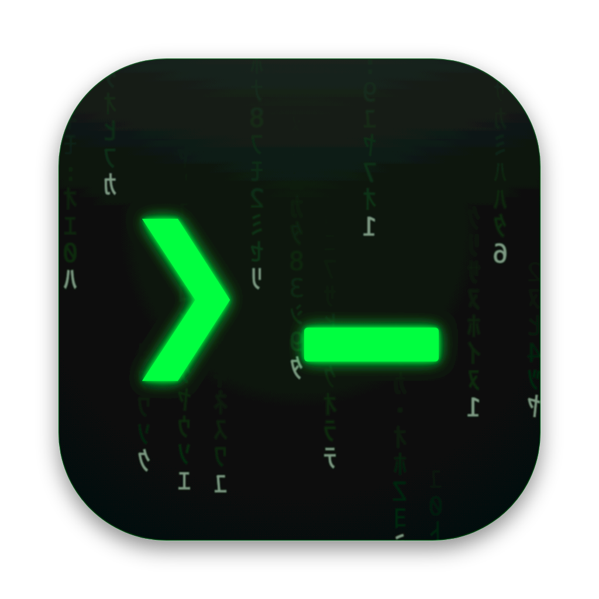
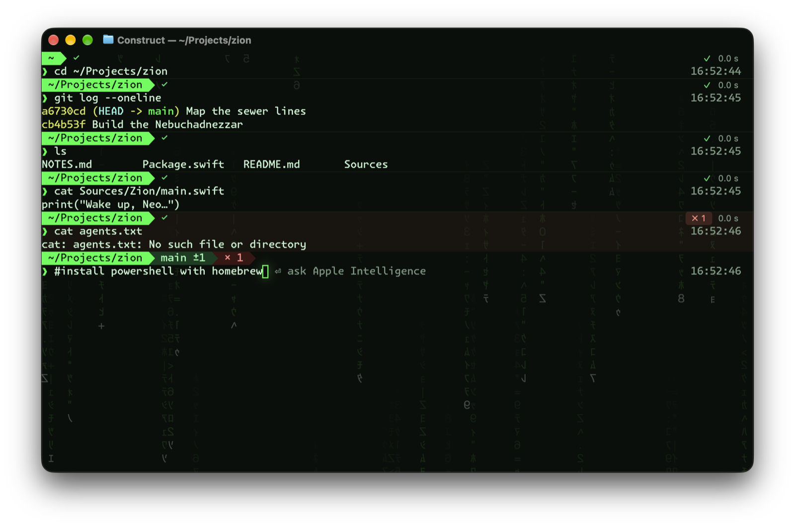
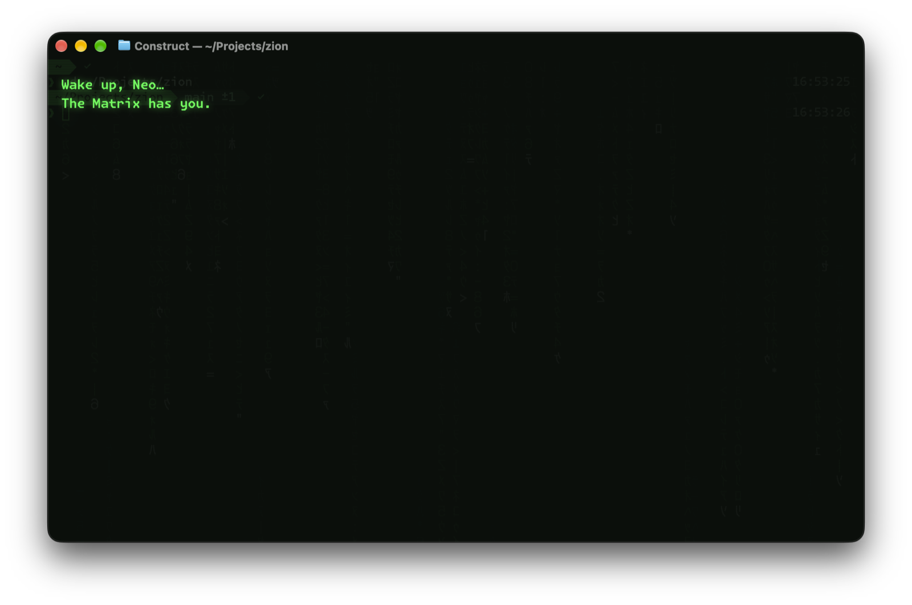
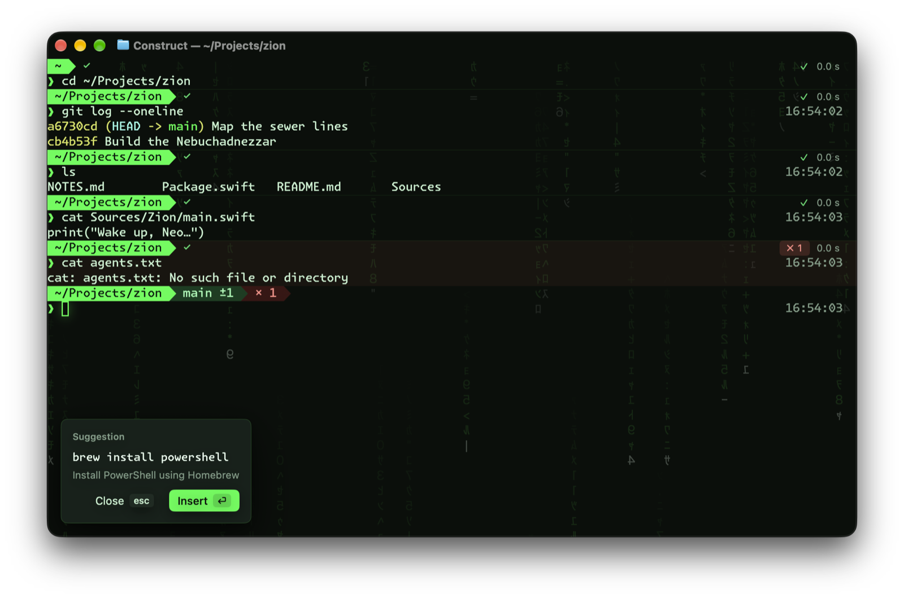

<p align="center"></p>

# Construct

[English](README.md) · **Español**

Emulador de terminal nativo para macOS con estética Matrix: lluvia digital tras el texto, paleta verde fósforo y un prompt propio. Usa [SwiftTerm](https://github.com/migueldeicaza/SwiftTerm) como motor, bloques de comandos, paleta de comandos, ventana Quake e IA local (Apple Foundation Models) que sugiere comandos sin ejecutarlos.

> Proyecto no oficial hecho por un fan. No está afiliado, respaldado ni relacionado con Warner Bros. ni con la franquicia *The Matrix*.



## Descarga

Descarga el último DMG notarizado desde [Releases](../../releases): ábrelo y arrastra **Construct** a Aplicaciones. Requiere macOS 27.2 o posterior.

## Funciones

| # | Función | Resumen |
|---|---|---|
| R1 | Terminal | Shell de login en un PTY (`TERM=xterm-256color`, `COLORTERM=truecolor`); vim, htop, less y tmux funcionan. |
| R2 | Tema Matrix | Paleta ANSI de 16 colores y ventana siempre oscura; fuente Monaspace Krypton NF. |
| R3 | Lluvia digital | Katakana y dígitos detrás del texto; se pausa con la ventana inactiva, Modo Bajo Consumo y Reducir movimiento. |
| R4 | Tres intensidades | Sutil, Equilibrado (por defecto) e Inmersivo. |
| R5 | Prompt propio | `usuario@equipo` (`prompt-user-host`), ruta completa (`prompt-path`), rama git, código de salida si falla, duración si pasa de 2 s y hora. Tu `~/.zshrc` no se modifica. |
| R6 | Integración de shell | OSC 133/7 para conocer inicio y fin de cada comando, código de salida y directorio. |
| R7 | Bloques de comandos | Marca lateral y chip de salida (código y duración); salto entre bloques; copiar comando o salida. |
| R8 | Pestañas y splits | Pestañas nativas, paneles divididos; lo nuevo hereda el directorio actual. |
| R9 | Paleta de comandos | Búsqueda difusa de acciones, historial y carpetas recientes. |
| R10 | Config por archivo | `~/.config/macterminal/config`, recarga en caliente; los errores salen en un aviso sin romper la app. |
| R11 | Ajustes | Apariencia, Prompt, Teclado, IA y Avanzado. |
| R12 | Ventana Quake | Terminal desplegable desde arriba con atajo global. |
| R13 | Autocompletado | Sugerencia en gris desde tu historial; `→` o `⌃F` la aceptan. |
| R14 | Búsqueda | Barra en el scrollback con contador. Resalta la coincidencia actual, no todas. |
| R15 | IA local | `#…`, `# …` o `?? …` + `⏎` propone un comando; solo se inserta tras confirmar. |

| «Wake up, Neo…» en cada ventana o pestaña nueva | Sugerencia de la IA local |
|---|---|
|  |  |

## Idiomas

La interfaz está en inglés y en español. macOS elige solo: con el sistema en español la ves en español; en cualquier otro idioma, en inglés. Para cambiarlo solo en esta app: Ajustes del Sistema ▸ General ▸ Idioma y región ▸ Aplicaciones. El saludo «Wake up, Neo…» sale en inglés en todos los idiomas: es la cita de la película.

## Requisitos

- macOS 27.2 o posterior (objetivo de despliegue del proyecto) y Xcode con Swift 6.
- zsh como shell para el prompt, los bloques y el autocompletado. Otro shell arranca, pero sin esas funciones.
- IA (`# …`): Mac compatible con Apple Intelligence, activado en Ajustes del Sistema. Sin él, la app avisa y el resto funciona igual.

## Compilar

Abre siempre el workspace. Hace falta `-skipPackagePluginValidation` porque SwiftTerm incluye un plugin de build. Para firmar con tu propia cuenta de desarrollador de Apple, elige tu equipo en Xcode (target ▸ Signing & Capabilities) o añade `DEVELOPMENT_TEAM=<tu team ID>` a los comandos de `xcodebuild`.

```bash
xcodebuild build -workspace Macterminal.xcworkspace -scheme Macterminal \
  -skipPackagePluginValidation -destination 'platform=macOS' \
  -derivedDataPath build/DerivedData -quiet
```

Tests de la lógica (paquete local):

```bash
swift test --package-path Packages/MacterminalCore
```

Tests vía Xcode: igual que el build, con `xcodebuild test`.

## Instalar el build Release

```bash
xcodebuild build -workspace Macterminal.xcworkspace -scheme Macterminal \
  -skipPackagePluginValidation -configuration Release \
  -destination 'platform=macOS' -derivedDataPath build/DerivedData -quiet
cp -R build/DerivedData/Build/Products/Release/Construct.app /Applications/
```

La app no está en el App Store ni usa sandbox. Si macOS bloquea la primera apertura, ábrela con clic derecho y Abrir.

## Atajos de teclado

Salen del catálogo de acciones (`TerminalAction`). Todos están en el menú y en la paleta (`⇧⌘P`).

| Acción | Atajo |
|---|---|
| Nueva ventana | `⌘N` |
| Nueva pestaña | `⌘T` |
| Cerrar panel | `⌘W` |
| Dividir verticalmente | `⌘D` |
| Dividir horizontalmente | `⇧⌘D` |
| Pestaña anterior / siguiente | `⇧⌘[` / `⇧⌘]` |
| Enfocar panel izquierdo, derecho, superior, inferior | `⌥⌘←` `⌥⌘→` `⌥⌘↑` `⌥⌘↓` |
| Paleta de comandos | `⇧⌘P` |
| Buscar | `⌘F` |
| Bloque anterior / siguiente | `⌘↑` / `⌘↓` |
| Copiar comando del bloque | `⇧⌘C` |
| Copiar salida del bloque | `⌥⇧⌘C` |
| Limpiar pantalla | `⌘K` |
| Aumentar / reducir / restablecer tamaño de letra | `⌘+` / `⌘-` / `⌘0` |
| Ajustes | `⌘,` |
| Mostrar u ocultar terminal Quake (global) | `⌃\`` |
| Aceptar sugerencia gris | `→` o `⌃F` |
| Insertar / cancelar sugerencia de IA | `⏎` / `esc` |

Cambiar de intensidad y recargar la configuración no tienen atajo: usa la paleta o Ajustes. El atajo Quake se cambia con `quake-hotkey`.

## Configuración

Archivo `~/.config/macterminal/config`, una línea `clave = valor`. Se recarga al guardar. Claves, rangos y valores por defecto en [docs/configuracion.md](docs/configuracion.md). `intensity` admite también los nombres ingleses `subtle`, `balanced` e `immersive`.

```
font-size = 14
intensity = inmersivo
prompt = true
background-opacity = 0.9
greeting-name = Neo
```

`greeting-name` es el nombre del saludo «Wake up, Neo…». La primera vez que abres la app te lo pregunta; si contestas «Ahora no» o lo dejas vacío, se usa el nombre de tu cuenta de macOS. Se cambia en Ajustes ▸ Apariencia o en el archivo.

### Intensidades

| | Sutil | Equilibrado | Inmersivo |
|---|---|---|---|
| Columnas activas | 18 % | 35 % | 60 % |
| Brillo de la cabeza | 0,14 | 0,25 | 0,45 |
| Brillo (glow) del acento | no | sí | más fuerte, y del texto |
| Scanlines y viñeta (CRT) | no | no | sí |
| «Wake up, Neo…» | al abrir y en cada ventana o pestaña nueva | al abrir y en cada ventana o pestaña nueva | al abrir y en cada ventana o pestaña nueva |

## IA con `# …`

Escribe en el prompt una línea que empiece por `#`, `# ` o `??`, por ejemplo `#instala powershell con homebrew`, `# busca archivos de más de 100 MB` o `?? comprime esta carpeta`, y pulsa `⏎`. Mientras escribes, la pista gris `⏎ preguntar a Apple Intelligence` indica que la línea irá a la IA; nunca se ejecuta como comando ni entra en el historial del shell. Las líneas que empiezan por `#!` y las de varias filas se ejecutan como siempre. El modelo del sistema (Apple Foundation Models, en el propio Mac, sin red) propone un comando con una explicación. Verás una tarjeta: `⏎` lo inserta en el prompt, `esc` lo descarta. Nunca se ejecuta solo; el `⏎` final es tuyo. Si el modelo no está disponible, la tarjeta explica el motivo (ver Ajustes, pestaña IA).

## Más documentación

- [Configuración](docs/configuracion.md)
- [Arquitectura](docs/arquitectura.md)
- [Cambios](CHANGELOG.md)

## Licencia

Construct se publica con la [licencia MIT](LICENSE). El nombre «Construct» y el icono de la app no forman parte de la licencia: si distribuyes una versión modificada, usa otro nombre y otro icono (consulta [TRADEMARK.md](TRADEMARK.md)). Los componentes de terceros y sus licencias están en [THIRD_PARTY_NOTICES.md](THIRD_PARTY_NOTICES.md).

Problemas de seguridad: consulta [SECURITY.md](SECURITY.md). Contribuciones: consulta [CONTRIBUTING.md](CONTRIBUTING.md).

## Más apps

Construct es obra de Aitor García. Encuentra mis otras apps para Mac en **[nexusappmx.com](https://nexusappmx.com)**.

## Créditos

- [SwiftTerm](https://github.com/migueldeicaza/SwiftTerm), licencia MIT (fijado a una revisión de `main` con la corrección de un desbordamiento de memoria en `reflowNarrower`).
- [Monaspace](https://github.com/githubnext/monaspace) Krypton NF, licencia SIL Open Font License 1.1 (texto en `Macterminal/Resources/Fonts/LICENSE-OFL.txt`).

## Notarización (distribución fuera de la App Store)

`scripts/notarize.sh` archiva en Release, firma con tu certificado **Developer ID Application**, crea un DMG firmado, lo envía al servicio de notarización de Apple, grapa el ticket y lo comprueba con Gatekeeper.

```bash
APPLE_ID=tu@correo.com scripts/notarize.sh --setup   # una vez: guarda una contraseña específica de app en el Llavero (perfil "construct-notary")
scripts/notarize.sh                # proceso completo → build/notarize/Construct-<versión>.dmg
scripts/notarize.sh --no-notarize  # solo firma y DMG, sin enviar a Apple
```

El equipo se toma del certificado Developer ID de tu Llavero; se puede cambiar con `TEAM_ID`, y el perfil del Llavero con `NOTARY_PROFILE`. La contraseña nunca se pasa por la línea de comandos ni se guarda en el repositorio.

El DMG usa una ventana personalizada estilo Matrix (fondo, disposición de iconos e icono del volumen) generada con [dmgbuild](https://github.com/dmgbuild/dmgbuild) 1.6.5 vía `uvx`; los recursos están en `scripts/dmg/` (`python3 -I scripts/dmg/build_background.py` regenera el fondo). Sin `uvx`, el script crea un DMG sencillo.
