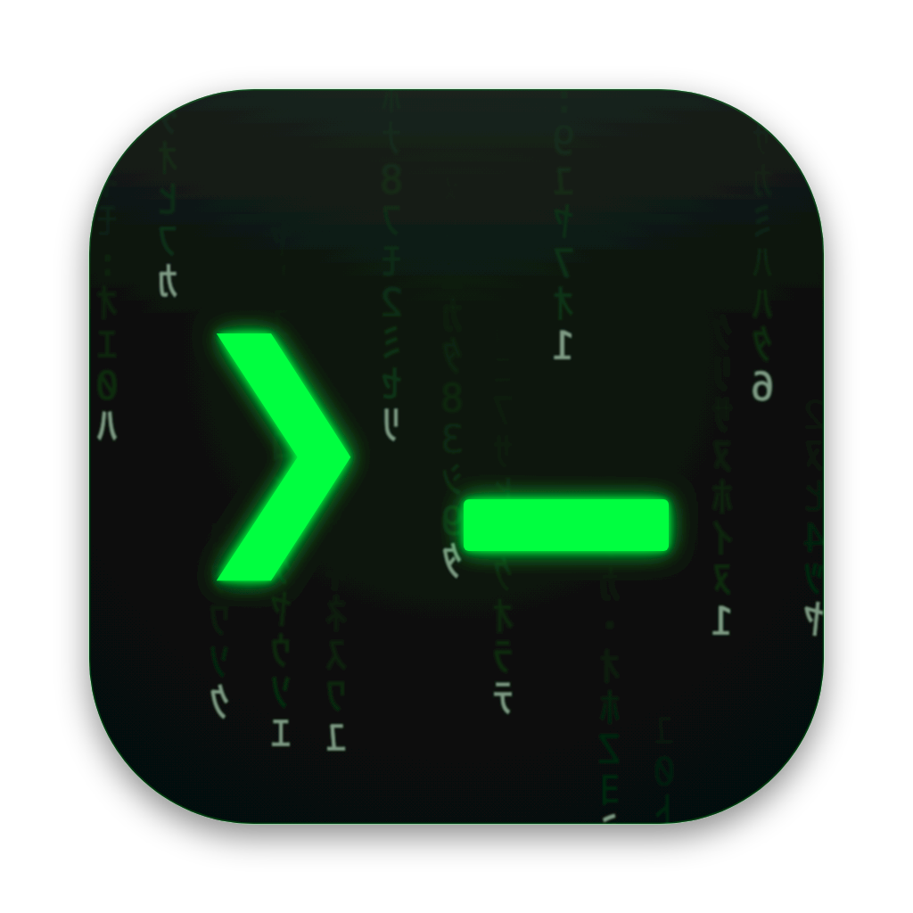
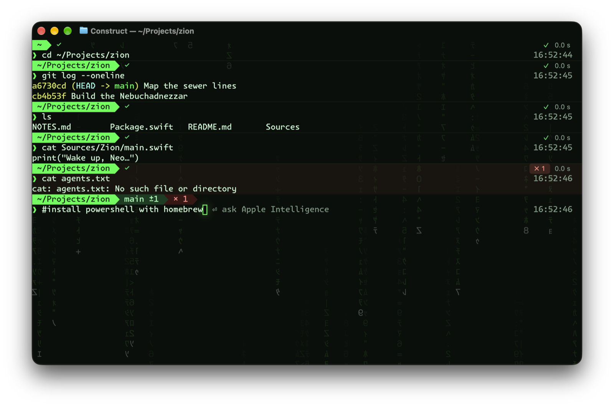
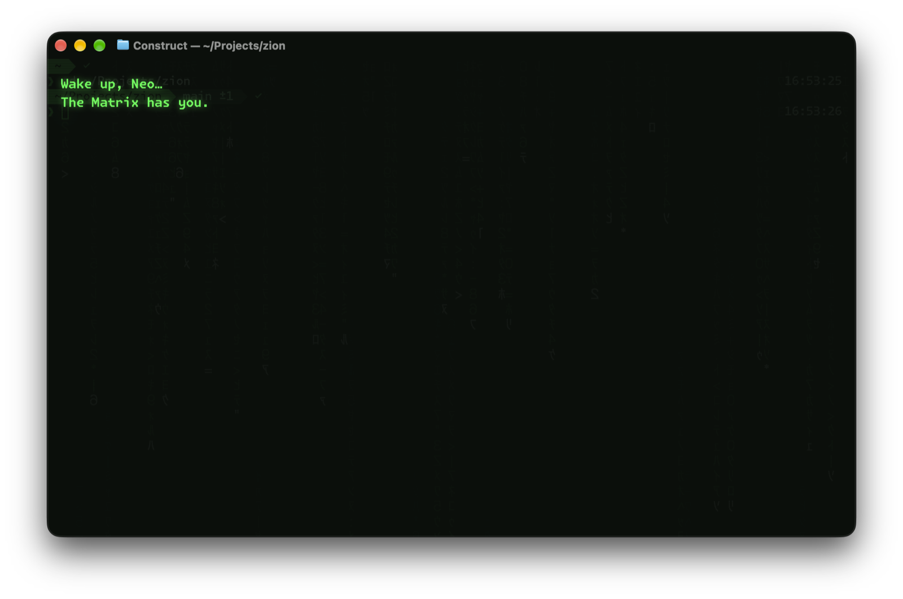
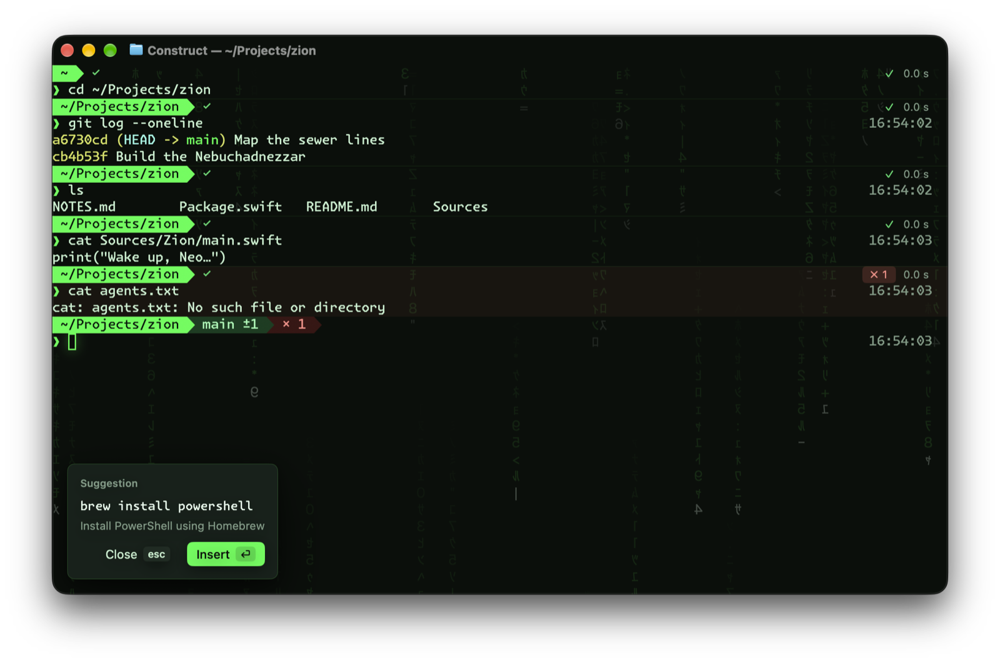

<p align="center"></p>

# Construct

**English** · [Español](README.es.md)

A native macOS terminal emulator with a Matrix look: digital rain behind the text, a phosphor-green palette and its own prompt. It uses [SwiftTerm](https://github.com/migueldeicaza/SwiftTerm) as the engine and adds command blocks, a command palette, a Quake window and on-device AI (Apple Foundation Models) that suggests commands without running them.

> Unofficial fan project. Not affiliated with, endorsed by or connected to Warner Bros. or *The Matrix* franchise.



## Download

Get the latest notarized DMG from [Releases](../../releases): open it and drag **Construct** to Applications. Requires macOS 27.2 or later.

## Features

| # | Feature | Summary |
|---|---|---|
| R1 | Terminal | Login shell in a PTY (`TERM=xterm-256color`, `COLORTERM=truecolor`); vim, htop, less and tmux work. |
| R2 | Matrix theme | 16-color ANSI palette and an always-dark window; Monaspace Krypton NF font. |
| R3 | Digital rain | Katakana and digits behind the text; pauses when the window is inactive, in Low Power Mode and with Reduce Motion. |
| R4 | Three intensities | Subtle, Balanced (default) and Immersive. |
| R5 | Custom prompt | `user@computer` (`prompt-user-host`), full path (`prompt-path`), git branch, exit code when a command fails, duration when it takes more than 2 s, and the time. Your `~/.zshrc` isn’t modified. |
| R6 | Shell integration | OSC 133/7 to know when each command starts and ends, its exit code and the directory. |
| R7 | Command blocks | Side marker and output chip (code and duration); jump between blocks; copy the command or its output. |
| R8 | Tabs and splits | Native tabs and split panes; new ones inherit the current directory. |
| R9 | Command palette | Fuzzy search over actions, history and recent folders. |
| R10 | File configuration | `~/.config/macterminal/config`, reloaded live; errors show up in a notice without breaking the app. |
| R11 | Settings | Appearance, Prompt, Keyboard, AI and Advanced. |
| R12 | Quake window | Drop-down terminal from the top of the screen with a global shortcut. |
| R13 | Autosuggestions | Gray suggestion from your history; `→` or `⌃F` accepts it. |
| R14 | Find | Bar over the scrollback with a counter. It highlights the current match, not all of them. |
| R15 | On-device AI | `#…`, `# …` or `?? …` + `⏎` suggests a command; it’s only inserted after you confirm. |

| “Wake up, Neo…” on every new window or tab | On-device AI suggestion |
|---|---|
|  |  |

## Languages

The interface is available in English and Spanish. macOS picks the language: with the system in Spanish you see it in Spanish; in any other language, in English. To change it for this app only: System Settings ▸ General ▸ Language & Region ▸ Applications. The “Wake up, Neo…” greeting is in English in every language: it’s the line from the film.

## Requirements

- macOS 27.2 or later (the project’s deployment target) and Xcode with Swift 6.
- zsh as the shell for the prompt, blocks and autosuggestions. Other shells start, but without those features.
- AI (`# …`): a Mac that supports Apple Intelligence, turned on in System Settings. Without it, the app tells you and everything else works the same.

## Build

Always open the workspace. `-skipPackagePluginValidation` is needed because SwiftTerm ships a build plugin. To sign with your own Apple developer account, choose your team in Xcode (target ▸ Signing & Capabilities) or add `DEVELOPMENT_TEAM=<your team ID>` to the `xcodebuild` commands.

```bash
xcodebuild build -workspace Macterminal.xcworkspace -scheme Macterminal \
  -skipPackagePluginValidation -destination 'platform=macOS' \
  -derivedDataPath build/DerivedData -quiet
```

Logic tests (local package):

```bash
swift test --package-path Packages/MacterminalCore
```

Tests through Xcode: same as the build, with `xcodebuild test`.

## Install the Release build

```bash
xcodebuild build -workspace Macterminal.xcworkspace -scheme Macterminal \
  -skipPackagePluginValidation -configuration Release \
  -destination 'platform=macOS' -derivedDataPath build/DerivedData -quiet
cp -R build/DerivedData/Build/Products/Release/Construct.app /Applications/
```

The app isn’t on the App Store and isn’t sandboxed. If macOS blocks the first launch, Control-click it and choose Open.

## Keyboard shortcuts

They come from the action catalog (`TerminalAction`). All of them are in the menu and in the palette (`⇧⌘P`).

| Action | Shortcut |
|---|---|
| New Window | `⌘N` |
| New Tab | `⌘T` |
| Close Pane | `⌘W` |
| Split Vertically | `⌘D` |
| Split Horizontally | `⇧⌘D` |
| Previous / Next Tab | `⇧⌘[` / `⇧⌘]` |
| Focus left, right, upper, lower pane | `⌥⌘←` `⌥⌘→` `⌥⌘↑` `⌥⌘↓` |
| Command Palette | `⇧⌘P` |
| Find | `⌘F` |
| Previous / Next Block | `⌘↑` / `⌘↓` |
| Copy Block Command | `⇧⌘C` |
| Copy Block Output | `⌥⇧⌘C` |
| Clear Screen | `⌘K` |
| Increase / decrease / default font size | `⌘+` / `⌘-` / `⌘0` |
| Settings | `⌘,` |
| Show or Hide Quake Terminal (global) | `⌃\`` |
| Accept the gray suggestion | `→` or `⌃F` |
| Insert / cancel the AI suggestion | `⏎` / `esc` |

Changing the intensity and reloading the configuration have no shortcut: use the palette or Settings. The Quake shortcut is changed with `quake-hotkey`.

## Configuration

File `~/.config/macterminal/config`, one `key = value` line each. It reloads when you save it. Keys, ranges and defaults in [docs/configuration.md](docs/configuration.md).

```
font-size = 14
intensity = immersive
prompt = true
background-opacity = 0.9
greeting-name = Neo
```

`intensity` accepts `subtle`, `balanced` and `immersive`, and also the original Spanish values `sutil`, `equilibrado` and `inmersivo`, so existing files keep working.

`greeting-name` is the name in the “Wake up, Neo…” greeting. The app asks for it the first time you open it; if you answer “Not Now” or leave it empty, your macOS account name is used. Change it in Settings ▸ Appearance or in the file.

### Intensities

| | Subtle | Balanced | Immersive |
|---|---|---|---|
| Active columns | 18 % | 35 % | 60 % |
| Head brightness | 0.14 | 0.25 | 0.45 |
| Accent glow | no | yes | stronger, and on the text too |
| Scan lines and vignette (CRT) | no | no | yes |
| “Wake up, Neo…” | on launch and every new window or tab | on launch and every new window or tab | on launch and every new window or tab |

## AI with `# …`

Type a line that starts with `#`, `# ` or `??` at the prompt, for example `#install powershell with homebrew`, `# find files larger than 100 MB` or `?? compress this folder`, and press `⏎`. While you type, a grey `⏎ ask Apple Intelligence` hint shows that the line will go to the AI; it never runs as a command or enters the shell history. Lines starting with `#!` and lines with several rows run as usual. The system model (Apple Foundation Models, on the Mac itself, no network) suggests a command with an explanation in the language of your request. A card appears: `⏎` inserts it at the prompt, `esc` discards it. It never runs by itself; the final `⏎` is yours. If the model isn’t available, the card explains why (see the AI tab in Settings).

## More documentation

- [Configuration](docs/configuration.md)
- [Architecture](docs/arquitectura.md) (Spanish)
- [Changes](CHANGELOG.md)

## License

Construct is released under the [MIT License](LICENSE). The name “Construct” and the app icon are not covered by the license: please use a different name and icon for forks you distribute (see [TRADEMARK.md](TRADEMARK.md)). Third-party components and their licenses are listed in [THIRD_PARTY_NOTICES.md](THIRD_PARTY_NOTICES.md).

Security issues: see [SECURITY.md](SECURITY.md). Contributions: see [CONTRIBUTING.md](CONTRIBUTING.md).

## More apps

Construct is made by Aitor García. Find my other Mac apps at **[nexusappmx.com](https://nexusappmx.com)**.

## Credits

- [SwiftTerm](https://github.com/migueldeicaza/SwiftTerm), MIT license (pinned to a `main` revision that fixes a memory overflow in `reflowNarrower`).
- [Monaspace](https://github.com/githubnext/monaspace) Krypton NF, SIL Open Font License 1.1 (text in `Macterminal/Resources/Fonts/LICENSE-OFL.txt`).

## Notarization (distribution outside the App Store)

`scripts/notarize.sh` archives a Release build, signs it with your **Developer ID Application** certificate, packages a signed DMG, submits it to Apple's notary service, staples the ticket and checks it with Gatekeeper.

```bash
APPLE_ID=you@example.com scripts/notarize.sh --setup   # once: stores an app-specific password in the Keychain (profile "construct-notary")
scripts/notarize.sh                # full run → build/notarize/Construct-<version>.dmg
scripts/notarize.sh --no-notarize  # sign + DMG only, no upload
```

The team is taken from the Developer ID certificate in your Keychain; override it with `TEAM_ID`, and the Keychain profile with `NOTARY_PROFILE`. The password is never passed on the command line or stored in the repository.

The DMG uses a custom Matrix-style window (background, icon layout and volume icon) built with [dmgbuild](https://github.com/dmgbuild/dmgbuild) 1.6.5 through `uvx`; assets live in `scripts/dmg/` (`python3 -I scripts/dmg/build_background.py` regenerates the background). Without `uvx` the script falls back to a plain DMG.
