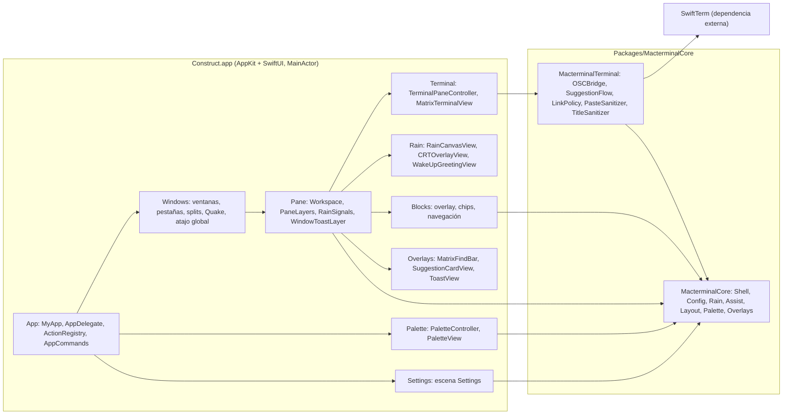
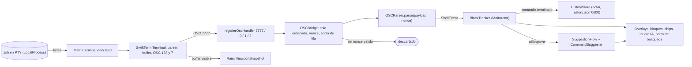
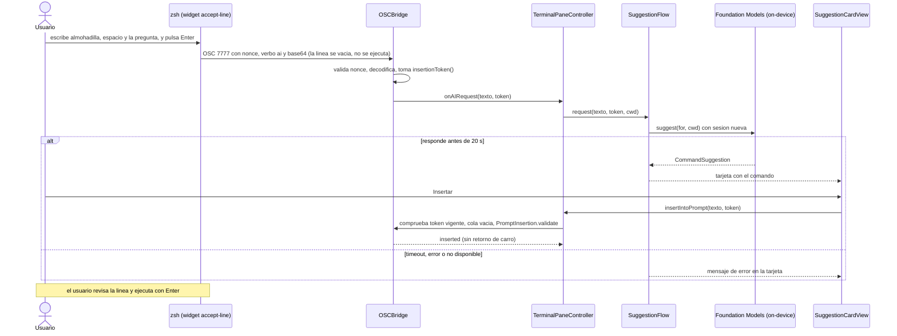
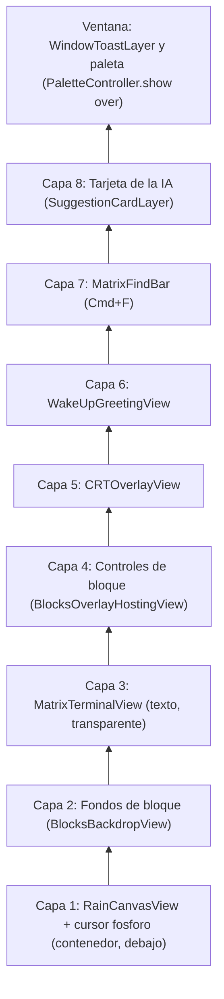
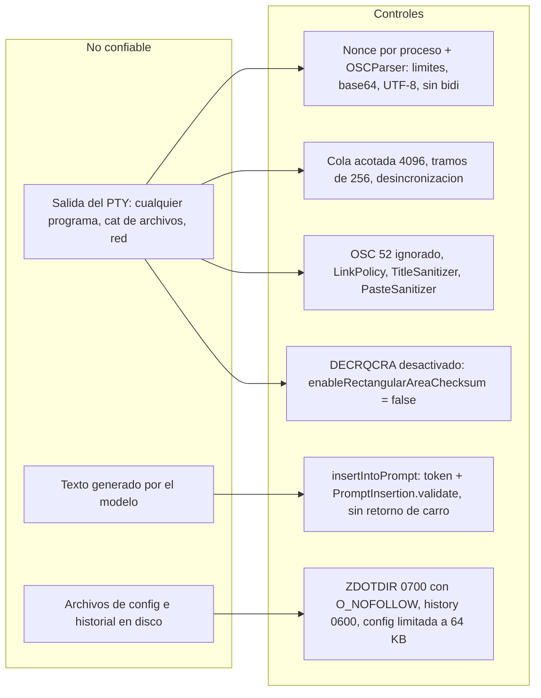

# Arquitectura de Construct

Terminal de macOS con lluvia estilo Matrix, bloques de comando, historial e IA local. Este documento describe el código construido (SwiftTerm `main@1488fac9`).

## Índice
1. [Módulos](#1-módulos)
2. [Flujo de bytes: PTY a overlays](#2-flujo-de-bytes-pty-a-overlays)
3. [Secuencia de `# pregunta`](#3-secuencia-de--pregunta)
4. [Orden de capas de la vista](#4-orden-de-capas-de-la-vista)
5. [Modelo de amenazas resumido](#5-modelo-de-amenazas-resumido)
6. [Diferencias con el plan](#diferencias-con-el-plan)

## 1. Módulos

`MacterminalCore` es lógica pura sin AppKit y se prueba con `swift test`. `MacterminalTerminal` es el único producto que depende de SwiftTerm, de modo que el puente OSC también se prueba sin la app. `Pane` es el montaje: cablea los módulos y es dueño de `Workspace` (un único `ConfigStore`, `HistoryStore` y `CommandSuggester`).

## 2. Flujo de bytes: PTY a overlays

El estado de la app sale solo de OSC 7777 con nonce de 32 hex por proceso. El handler es síncrono y encola; tras cada `feed` se drena en tramos de 256 hacia `BlockTracker`. Si la cola pasa de 4096 se llama a `desynchronize()` y se rearma con el siguiente `A` autenticado. OSC 133/7 los gestiona SwiftTerm, nunca la app. Las filas son absolutas del buffer; la lluvia recibe filas de la vista mediante `ViewportSnapshot`.

## 3. Secuencia de `# pregunta`

La IA recibe solo la petición y el cwd, nunca la salida del terminal. `insertIntoPrompt` devuelve `inserted`, `notAtPrompt`, `stale` o `unsafe`. Con `stale` (otro prompt desde la petición) o con eventos pendientes en la cola (A11) no se escribe nada. Nunca se envía `\r`: ejecutar siempre lo decide el usuario.

## 4. Orden de capas de la vista

De abajo arriba. Las capas 1 y 2 son hermanas de la terminal, bajo ella; de la 4 a la 8 son subvistas de la terminal, para que la barra Cmd+F quede sobre controles y CRT. El fondo y su opacidad son del contenedor de la ventana: las capas del panel son transparentes. La tarjeta recibe el foco al aparecer y lo devuelve a la terminal al cerrarse.

## 5. Modelo de amenazas resumido

Tabla resumida de amenazas y mitigaciones.

| Amenaza | Mitigación |
|---|---|
| La salida de un programa falsifica bloques, cwd, historial o IA | Nonce por proceso entregado en `MACTERMINAL_NONCE`; el `.zshenv` lo guarda sin exportar y hace `unset`; sin nonce válido se descarta |
| Flood de secuencias | Descarte previo a encolar, cola de 4096, tramos de 256, `desynchronize()` |
| Escritura no deseada en el PTY por IA, historial o paleta | Único punto `insertIntoPrompt(_:token:)`, prompt vigente, validación, sin `\r` |
| Portapapeles, enlaces y títulos | OSC 52 de escritura ignorado y lectura sin respuesta; solo `http`, `https` y `mailto` con Cmd+clic; títulos saneados |
| Desbordamiento en `reflowNarrower` de SwiftTerm (CWE-787) | Pin a `1488fac9`, que incluye la corrección 12de9933; volver a un pin por versión al publicarse la siguiente release |
| Datos personales | Historial 0600, sin comandos con espacio inicial ni `# …`; logs sin texto de comandos, salida ni rutas |
| Scripts temporales manipulados | Directorio 0700 con `O_NOFOLLOW`, archivos con `O_EXCL` y `rename`; el `~/.zshrc` real no se toca |

Sin red ni autenticación propias: la IA corre en el dispositivo. Entitlement único `automation.apple-events`, con Hardened Runtime.

## Diferencias con el plan

- Búsqueda: el plan preveía `TerminalFindBar` de SwiftTerm; se usa `MatrixFindBar` propia, sin resaltado de todas las coincidencias (decisiones.md, R14).
- DECRQCRA: `ScreenChecksumFilter` propio sustituido por `enableRectangularAreaChecksum = false` (F5 I1).
- SwiftTerm: el plan fijaba 1.99.3; el código usa `main@1488fac9`.
- Capas: el plan solo citaba "Pane: montaje"; el orden real de capas está en `PaneLayers.swift` y se dibuja aquí. Los toasts son de la ventana, no del panel.
- Paleta: se presenta sobre la ventana (`PaletteController.show(over:)`), no como capa del panel.
